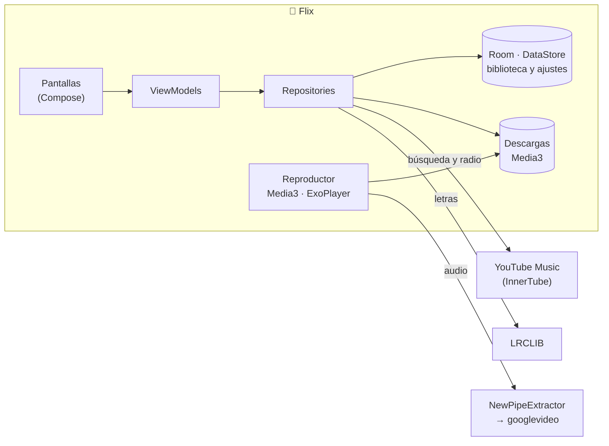

<p align="center">
  
</p>

<p align="center">
  <b>Tu música de YouTube Music, en una app nativa, oscura y sin anuncios.</b><br>
  Sin cuenta, sin servidor: todo ocurre en tu teléfono.
</p>

<p align="center">
  <a href="../../releases/latest"></a>
</p>

<p align="center">
  
  
  
  
</p>

---

## Qué es Flix

Flix es un reproductor de música para Android que busca y reproduce canciones del catálogo de YouTube Music. Está pensado como **una sala de cine a oscuras**: el fondo desaparece, la portada es la pantalla y un único haz de luz violeta, **Lumen**, marca lo que está sonando.


- **Buscar → reproducir en dos toques.** Resultados en menos de un segundo, filtros por canciones, artistas y álbumes.
- **Reproductor completo.** Cola reordenable, aleatorio, repetir, controles en la pantalla de bloqueo y en los auriculares, y la música sigue con la pantalla apagada.
- **Letras sincronizadas.** La línea que suena se ilumina y la pantalla avanza sola; toca una línea para saltar a ese momento.
- **Modo offline.** Descarga canciones o playlists enteras, con su letra, y escúchalas sin conexión.
- **Reproducción automática.** Cuando se acaba la cola, sigue con música parecida (la radio de YouTube Music).
- **Tu biblioteca, en tu teléfono.** Favoritos, playlists, álbumes guardados, artistas que sigues e historial, guardados en local.
- **Estadísticas.** Tu semana, mes o año en música: actividad diaria, artistas más escuchados y tu canción top, calculado en el propio teléfono.
- **Tema claro y oscuro**, pensado para pantallas de 120 Hz y con soporte para TalkBack y "quitar animaciones".

## Instalar

1. Descarga `Flix-x.y.z.apk` de la [última versión](../../releases/latest).
2. Ábrelo en el teléfono. Si Android lo pide, permite **instalar apps desconocidas** para la app con la que lo abriste.
3. Si **Google Play Protect** pregunta, puedes dejar que la analice. La avisa como "desconocida" porque no viene de Play Store, no porque haga algo raro.

Requiere Android 8.0 (API 26) o superior.

## Cómo funciona

Flix no tiene servidor propio. El teléfono habla directamente con cada servicio, como lo haría un navegador:



| Pieza | Para qué |
|---|---|
| **YouTube Music (InnerTube)** | La misma API que usa su web. Búsqueda de canciones y radio para la reproducción automática, sin cuenta. |
| **NewPipeExtractor** | Lee la página del vídeo y resuelve en el teléfono el enlace directo del audio (m4a/AAC). Como la petición sale de tu red, YouTube ve a un usuario normal. |
| **Media3 / ExoPlayer** | Reproducción en segundo plano, notificación y controles del sistema. Precarga la canción entera y resuelve por adelantado las dos siguientes. |
| **LRCLIB** | Letras libres y sin cuenta, sincronizadas cuando existen. |
| **Room · DataStore** | Favoritos, playlists, historial, estadísticas y ajustes: nunca salen del teléfono. |

## Arquitectura

Un módulo (`:app`) organizado como si fueran módulos: `core/` (modelo, datos, reproductor, sistema de diseño) y `feature/` (una carpeta por pantalla). Flujo de datos unidireccional: la UI dibuja un `UiState` y envía eventos al ViewModel, que habla con repositories definidos como interfaces.

Los detalles y las reglas están en [`ARCHITECTURE.md`](ARCHITECTURE.md).

| | |
|---|---|
| Lenguaje | Kotlin 2.4 |
| UI | Jetpack Compose · Material 3 · Navigation con rutas tipadas |
| Inyección | Hilt |
| Datos | Room · DataStore · OkHttp · kotlinx.serialization |
| Reproducción | Media3 (ExoPlayer, MediaSession, descargas) |
| Imágenes | Coil 3 |
| Tests | JUnit · kotlinx-coroutines-test, con repositories falsos y respuestas reales guardadas |

## Compilar

Necesitas **Android Studio** (trae su propio JDK) o un JDK 17+.

```bash
git clone https://github.com/Jhon-David-Toro/FlixMusic-App.git
cd FlixMusic-App
./gradlew testDebugUnitTest      # tests
./gradlew assembleDebug          # APK de desarrollo
./gradlew assembleRelease        # APK optimizada con R8
```

La APK queda en `app/build/outputs/apk/<debug|release>/`. La versión `release` se firma con la clave de depuración de tu equipo, así que sirve para instalarla en tus dispositivos.

## Aviso

Flix es un proyecto personal y sin ánimo de lucro. No está afiliado a YouTube, Google ni LRCLIB, y no aloja ni redistribuye contenido: reproduce lo que YouTube Music ofrece públicamente, como lo harías desde su web. Úsalo de forma responsable y respetando los términos de cada servicio.

## Licencia

[GPL-3.0](LICENSE). Flix usa [NewPipeExtractor](https://github.com/TeamNewPipe/NewPipeExtractor), que también es GPL-3.0, así que cualquier versión distribuida debe publicar su código bajo la misma licencia.
